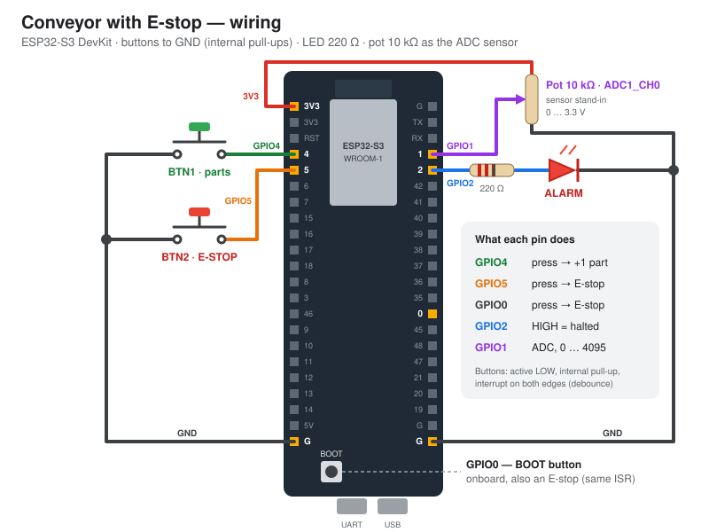
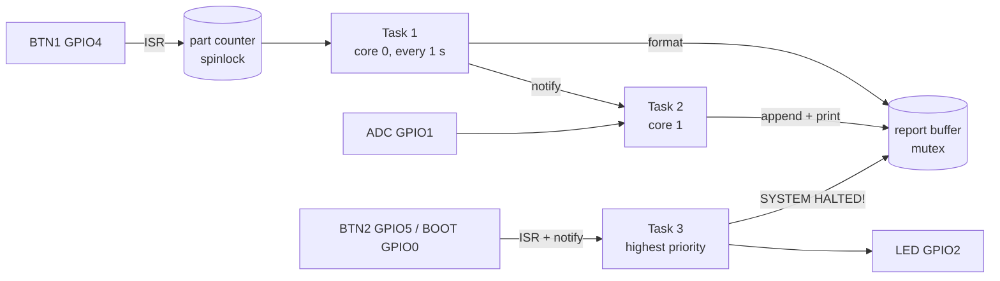

# Lesson 6.5: Multicore, ISRs and shared resources

A conveyor model on the ESP32-S3. One button counts parts through an interrupt. Two tasks on **different cores** build one shared report line every second: one adds the speed, the other adds an ADC reading. An emergency-stop button wakes the highest-priority task, which turns on the alarm LED, writes `SYSTEM HALTED!` and blocks the conveyor. The task text is in [TASK.md](TASK.md).

Board: ESP32-S3 DevKit, ESP-IDF v6.0.1.

## 🔌 Wiring



<details>
<summary>Text version</summary>

| Part | Pin | Other side | Active level |
|---|---|---|---|
| BTN1 (parts sensor) | GPIO4 | GND | LOW (internal pull-up) |
| BTN2 (E-stop) | GPIO5 | GND | LOW (internal pull-up) |
| BOOT button (E-stop too) | GPIO0 | GND, onboard | LOW |
| Alarm LED + 220 Ω | GPIO2 | GND | HIGH = halted |
| Potentiometer 10 kΩ (sensor stand-in) | GPIO1 = ADC1_CH0 (wiper) | ends to 3V3 and GND | 0 … 3.3 V |

</details>

## How it works



| Shared thing | Who uses it | Protection | Why this one |
|---|---|---|---|
| Part counter + halt flag | BTN1 ISR, Tasks 1 and 3, on both cores | `portMUX` spinlock | An ISR may not wait for a mutex. Disabling interrupts stops only one core, and the spinlock also stops the other one. |
| Report buffer `char[160]` | Tasks 1, 2, 3 (never an ISR) | one mutex | Task 1 and Task 2 run at the same time on two cores. Without the lock their writes could mix in one line. |
| Order "format, then append" | Task 1 → Task 2 | task notification | If both tasks just ran once per second, Task 2 could append before Task 1 formats, and the ADC part would be overwritten. |
| E-stop wake-up | BTN2/BOOT ISR → Task 3 | `vTaskNotifyGiveFromISR` + `portYIELD_FROM_ISR` | Task 3 runs right after the ISR, not at the next tick. It uses no CPU while it waits. |

**Debounce:** buttons bounce on press **and** on release. The ISRs fire on both edges. The first edge after 50 ms of quiet flips the button state, and only the flip to "pressed" counts. That way bounce on release doesn't count twice, and the E-stop still reacts on the very first edge.

**Halt:** Task 3 first sets the halt flag (under the spinlock) and turns off BTN1's interrupt, then turns on the LED, then writes `SYSTEM HALTED!` under the mutex. Tasks 1 and 2 stop writing. Pressing E-stop again prints `already halted, parts=N`, so you can see that the counter has stopped.

## Build and flash

```bash
. ~/.espressif/tools/activate_idf_v6.0.1.sh
idf.py set-target esp32s3      # only once, sdkconfig is not in git
idf.py build flash monitor
```

Serial output, one line per second:

```text
[core 0] parts=3 speed=180/min | [core 1] adc=4095 raw ...
SYSTEM HALTED! (core 0, parts=3)
already halted, parts=3
```

## 🖥️ Simulate in Wokwi

The circuit is in [`diagram.json`](diagram.json). [`wokwi.toml`](wokwi.toml) points to the real ESP-IDF build, so the simulator runs exactly this firmware.

- **VS Code:** install the *Wokwi Simulator* extension, run `idf.py build`, then F1 → *Wokwi: Start Simulator*. Click BTN1 to count, turn the pot, then click BTN2 or BOOT to halt.
- Wokwi's DevKitC-1 has no clickable BOOT button, so the diagram adds one on **GPIO0**. The pot stands in for the ADC sensor.
- Wokwi's buttons bounce like real ones, which is how the release-bounce bug was found.
- In Wokwi the calibrated mV value is wrong (full scale reads about 5090 mV). The raw ADC value is fine.

## ✅ Automated test

[`test/wokwi-scenario.yaml`](test/wokwi-scenario.yaml) runs the firmware on Wokwi's servers with [`wokwi-cli`](https://docs.wokwi.com/wokwi-ci/getting-started). It presses the buttons, turns the pot, and checks the serial text and the LED pin. It needs a free token from https://wokwi.com/dashboard/ci in `WOKWI_CLI_TOKEN`:

```bash
wokwi-cli --timeout 30000 --scenario test/wokwi-scenario.yaml .
```

| Step | Check | Result |
|---|---|---|
| Start | `[core 0] parts=0 speed=0/min \| [core 1] adc=…` (both cores, right order) | ✅ |
| 3 × BTN1 | `parts=3`, `speed=180/min` (3 parts in 1 s × 60) | ✅ |
| Pot to the end | `adc=4095` | ✅ |
| Before E-stop | LED pin LOW | ✅ |
| BTN2 | `SYSTEM HALTED!`, LED pin HIGH, reports stop | ✅ |
| 3 × BTN1 after the halt, then BTN2 again | `already halted, parts=3` (not 6) | ✅ |

The last step was also checked the other way round. With the blocking removed from the code on purpose, the test printed `parts=6` and failed.

The test found two bugs on the way: first a press counted twice (bounce on release), then a press was missed (the ISR read the pin level during bounce). Both are fixed by the two-edge debounce above.
